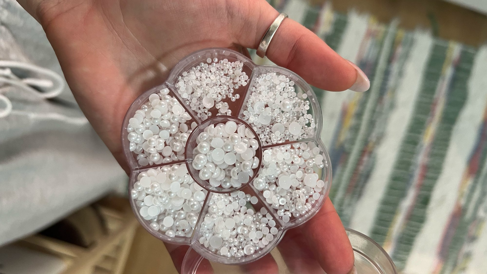
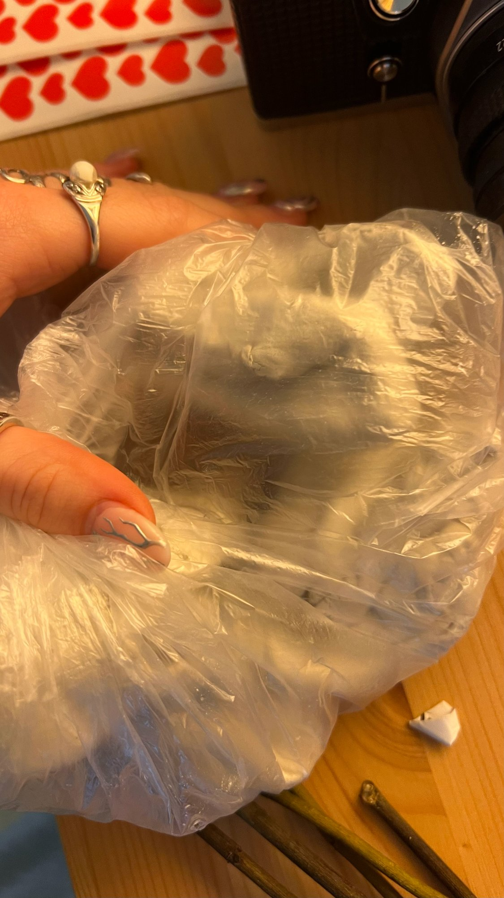
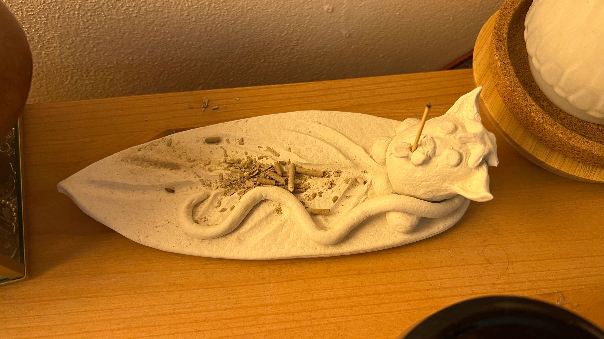

# How I Made the Letterform M

I made my Letterform by hand, without any digital tools. The only tools I used were my fingers and a knife.

## Materials

- Air-dry modelling clay
- Half-pearl beads that I normally use for nail art
- A knife for cutting out the letter

## Process

1. I softened the clay in my hands. Between sessions I kept it wrapped in a plastic bag so it would not dry out.
2. I flattened the clay into a thick slab with my fingers.
3. I cut out the shape of the M with a knife and smoothed the edges by hand.
4. I pressed the pearl beads into the soft clay one by one. I placed the most beads at the ends of the legs and fewer in the middle.
5. I left the letter to dry.

## A side project

I had some clay left over, so I also made an incense holder in the shape of a leaf with a small cat curled up at one end. It was not planned. It came from playing with the material.

## Alternate alt text

Each description of the Letterform emphasizes something different.

- **Shape and detail:** A capital M made of pink clay, with two straight legs and a deep V in the middle that does not reach the bottom. Hundreds of small pearl beads cover the surface.
- **Texture:** A soft, uneven pink clay surface shows fingerprints and small cracks. Smooth, shiny pearls sit in it like drops of water.
- **Mood:** A soft pink M glows against total darkness. The pearls make it look like something sweet and fragile, like frosting or sea foam.

## References

- [Course Resources](https://jgagne.github.io/psie-26-27-vskk/syllabus-winter.html#resources)
- Dave Rupert, [Alt Attributes Like Paragraphs](https://daverupert.com/2020/09/alt-attributes-like-paragraphs/)
- Léonie Watson, [Text descriptions and emotion rich images](https://tink.uk/text-descriptions-and-emotion-rich-images/)
- Peter Gasston, [The importance of semantics on the web](https://broken-links.com/2010/03/03/the-importance-of-semantics-on-the-web/)

[The finished Letterform and Haiku](index.md)
